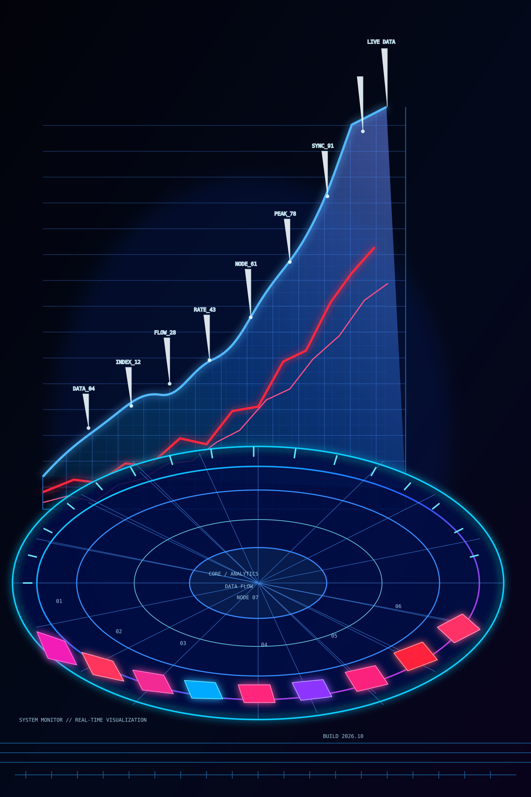

# César Jaimes

### Tecnología · Sistemas de Información · Automatización

*Aprendiendo a construir herramientas digitales que resuelvan problemas reales.*

---

## 👋 Sobre mí

Estudio **Tecnología y Sistemas de la Información** y estoy construyendo mis habilidades en programación y desarrollo de soluciones digitales. Me interesa combinar tecnología, datos y procesos para crear herramientas útiles, claras y fáciles de usar.

## 🛠️ En qué estoy trabajando

### SAUCE ERP / CRM — prototipo en desarrollo

Una idea de sistema para organizar operaciones y facilitar el seguimiento de información, con funciones como:

- Control de inventario y alertas de existencias.
- Registro de lotes y fechas de caducidad.
- Gestión y seguimiento del flujo de clientes.
- Una interfaz práctica para consultar y actualizar datos.

## 🌱 Tecnologías que estoy aprendiendo

  
  
  
  
  

## 🎯 Lo que me interesa

- Sistemas empresariales, ERP y CRM.
- Automatización de tareas y procesos.
- Desarrollo web y diseño de interfaces.
- Organización de inventarios y datos.

---

**Paso a paso, proyecto a proyecto.** 🚀

