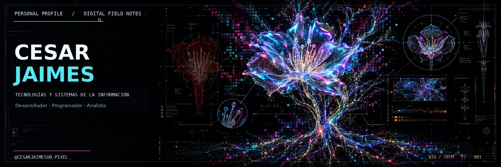
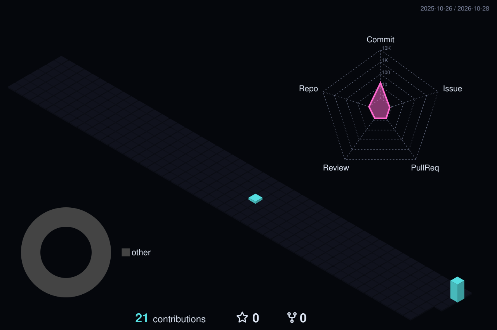

<!-- Perfil personal | estética cyber-botánica holográfica -->

  

<h1 align="center">CESAR JAIMES</h1>
<h3 align="center">Desarrollador · Programador · Analista</h3>

<strong>Desarrollo de soluciones de Inteligencia Artificial</strong>

<em>Estudios: Tecnologías y Sistemas de la Información</em>

  
  
  

---

### PERFIL // 01

Soy **Cesar Jaimes**, desarrollador, programador y analista. Me enfoco en comprender problemas, analizar necesidades y convertir ideas en soluciones de software útiles. Mi interés principal es desarrollar soluciones apoyadas en **inteligencia artificial**, automatización y tecnología que ayude a mejorar procesos.

Trabajo desde una mentalidad analítica, con curiosidad técnica y aprendizaje continuo: entender el problema, diseñar una solución, construirla y mejorarla.

### ÁREAS DE INTERÉS // 02

- **Desarrollo de software:** aplicaciones y herramientas orientadas a necesidades reales.
- **Programación:** lógica, resolución de problemas y mejora continua.
- **Análisis:** comprensión de requisitos, procesos y oportunidades de optimización.
- **Soluciones de IA:** explorar e integrar inteligencia artificial en flujos y herramientas.
- **Automatización:** simplificar tareas y mejorar la eficiencia.

### CONJUNTO DE HABILIDADES // 03

  
  
  
  
  
  
  
  

### CONTRIBUTIONS IN THE LAST YEAR // 04

  

CONTRIBUTION TERRAIN / REAL GITHUB ACTIVITY / DAILY REFRESH

### ESTADÍSTICAS DE GITHUB // 05

  
  

  

### CONEXIÓN // 06

  

CYBER-BOTANICAL SYSTEMS · ANALYZE / BUILD / EVOLVE

